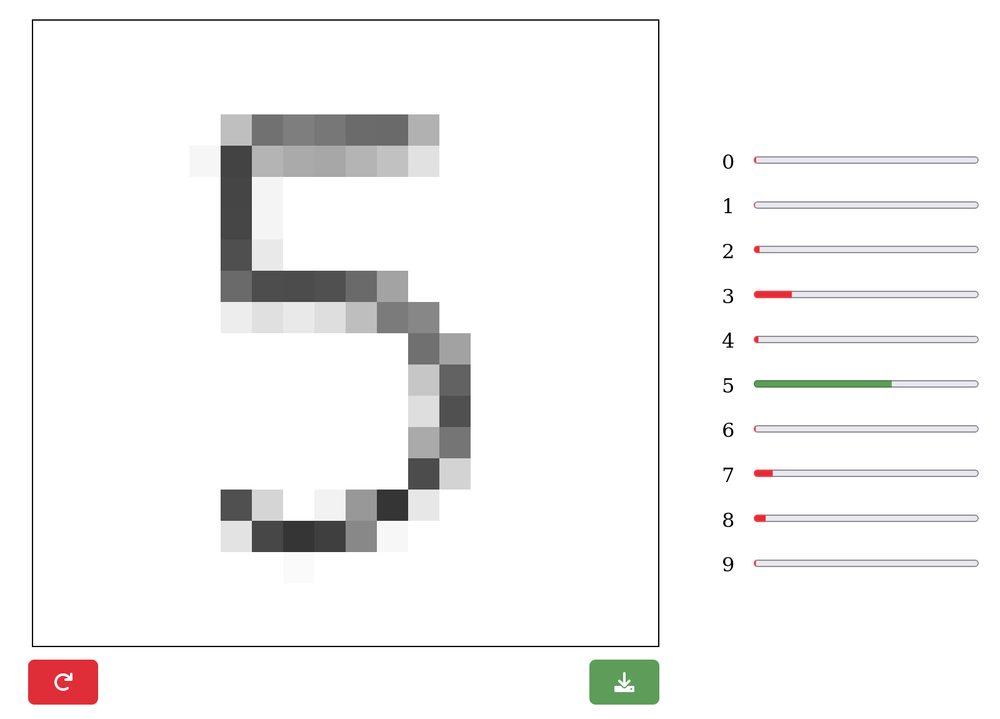
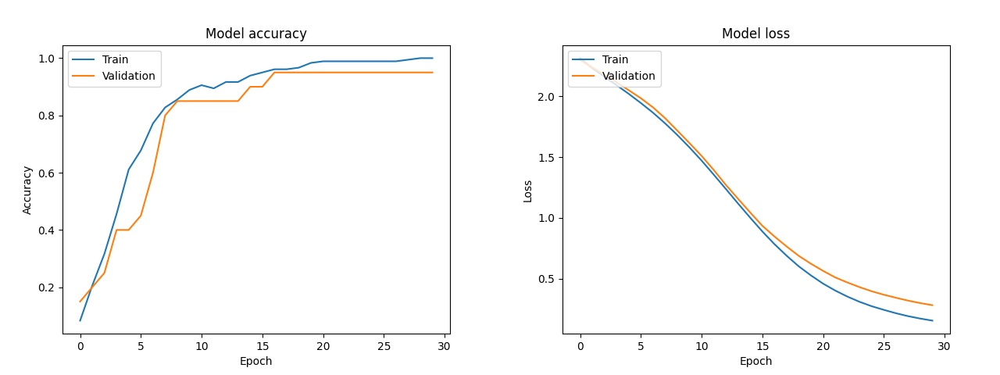

# Handwritten Digit OCR

Draw a digit with the mouse and a **neural network recognises it in real time** – a small OCR web app with a JavaScript frontend, a **FastAPI** REST backend and a **Keras** model trained on a hand-made dataset.

<p align="center"></p>

> hepia (HES-SO Geneva) · Computer Vision · 2024 · Solo project
> 📄 [Report (French)](docs/report-fr.pdf)

## How it works

```
 Browser (HTML5 canvas, 20×20)  ──POST /post-canvas (JSON pixels)──▶  FastAPI  ──▶  Keras model
          ▲                                                                              │
          └──────────────── probabilities for each digit (0-9) ◀─────────────────────────┘
```

- **Frontend** – a 20×20 px HTML5 canvas, scaled up to 500×500 px with CSS so it can be drawn on. After every stroke, the pixels are sent to the API and ten progress bars show the confidence for each digit. Drawings can also be downloaded, which is how the dataset was built.
- **API** – FastAPI serves the page and the `/post-canvas` route: it binarises the image (threshold 220), shifts the digit to the top-left corner and returns the model's prediction.
- **Model** – a fully connected (non-convolutional, as required) network built with Keras.

## Dataset & training

No ready-made dataset such as MNIST was allowed: I drew my own digits through the frontend, varying position, size and handwriting style. Two versions are provided: 20 and 50 images per digit (`assets/numbers_*.tar.xz`).

Images go through the same normalisation as in the API (thresholding + shift to the top-left corner) to reduce the variability the network has to learn.

| Parameter | Value | Parameter | Value |
|---|---|---|---|
| Input | 400 (20×20, flattened) | Optimizer | Adam, learning rate 1e-4 |
| Hidden layers | 512 → 256 → 128, ReLU | Batch size | 32 |
| Output | 10 classes, softmax | Epochs | 30 |
| Validation split | 10 % | Loss | categorical cross-entropy |

<p align="center"></p>

The model reaches about **95 % validation accuracy** with only 20 drawings per digit. Validation accuracy plateaus while training accuracy reaches 100 %, a sign of slight overfitting given the small dataset; a convolutional network and size normalisation of the digits would be the next improvements.

## Getting started

Requirements: Python 3.10+.

```bash
python3 -m venv .venv && source .venv/bin/activate
pip install -r requirements.txt

# optional: retrain the model (a trained model is already provided in models/)
mkdir -p assets/numbers && tar -xf assets/numbers_20.tar.xz -C assets/numbers
python3 neural_network.py

# start the app
uvicorn api:app --reload
```

Then open <http://127.0.0.1:8000> and draw a digit.

## Project structure

```
├── api.py              FastAPI app: serves the frontend, prediction route
├── neural_network.py   dataset loading, model definition, training and plots
├── frontend/           HTML / CSS / JavaScript (canvas, API calls, progress bars)
├── assets/             hand-drawn datasets (20 and 50 images per digit)
├── models/             trained model (model.h5)
└── docs/               report, screenshot, training curves
```

## Tech

Python · TensorFlow / Keras · scikit-learn · NumPy · FastAPI · Uvicorn · JavaScript · HTML5 canvas

## License

[MIT](LICENSE)
